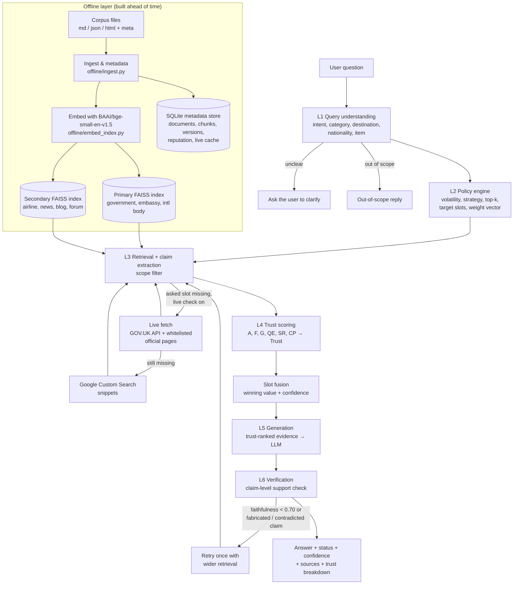

# TrustRAG system design

How the system answers a travel-advisory question, what S0–S3 do differently, every trust
formula as implemented, how it behaves when parts fail, and how to try it from the UI.
All numbers are the values in `trustrag/config.benchmark.yaml` and `trustrag/policies/`
unless stated otherwise. Code references are given as `file:function`.

## 1. Architecture



| Layer | Code | Purpose |
|---|---|---|
| Offline ingest/index | `offline/ingest.py`, `offline/embed_index.py`, `offline/knowledge_store.py` | Clean documents, record provenance (source type, authority, dates, nationality scope), chunk (≤180 words), embed, store in two FAISS indexes plus SQLite |
| Change tracking | `offline/change_detect.py`, `offline/scheduler.py` | Content hashes and diff size per version; change events feed the volatility score |
| L1 Query understanding | `online/query/intent.py`, `online/query/classifier.py` | Intent and category (trained classifier, keyword rules as fallback), entities, clarify/out-of-scope decisions |
| L2 Policy | `online/policy/engine.py`, `online/policy/volatility.py`, `online/policy/weights.py` | Volatility level, retrieval strategy, target slots, weight vector |
| L3 Retrieval | `online/retrieval/search.py`, `online/retrieval/evidence.py`, `pipeline.py:_retrieve_with_fallback` | Vector search, filters, slot-value extraction, live/Google fallback |
| L4 Trust | `online/trust/scoring.py`, `online/trust/fusion.py`, `online/trust/pipeline.py` | Per-evidence trust, then one value per slot |
| L5–L6 Answer | `online/generation/generate.py`, `llm.py`, `verify.py` | Evidence-bounded generation, claim verification, retry, status |
| Interfaces | `ui/app.py` (Streamlit), `trustrag/api.py` (FastAPI), `trustrag/cli.py` | Demo chat, HTTP API, command line |
| Evaluation | `experiments/`, `scripts/build_dataset.py` | Benchmark build, fitting, S0–S3 runs, statistics, sensitivity study |

The README's `src/temporal_hallucination/...` layout is an early scaffold that was never
built; the code lives in `trustrag/`. Updating the README is the next documentation task.

## 2. One question, step by step

Example: *"How long can Indian tourists stay in Thailand?"*

**Step 1: Query understanding (L1).**
- Intent ∈ {travel_entry, health_safety, customs_regulations, out_of_scope} and category ∈
  {visa_policy, vaccination_requirement, customs_regulation}. Predicted by calibrated logistic
  regression over bge-small embeddings when trained models exist (`make train-classifiers`),
  otherwise by keyword rules (`policies/query.yaml`).
- Entities by alias lookup: destination (Thailand), nationality from an adjective ("Indian";
  defaults to India and sets flag `nationality_defaulted`), customs item (drone, medicine, …).
- Decision:
  - OUT_OF_SCOPE if intent = out_of_scope with confidence ≥ 0.60.
  - CLARIFY if intent confidence < 0.40, category unknown, no destination, **or the two best
    categories are near-tied** (top confidence < 0.55 and gap ≤ 0.15).
  - Otherwise RETRIEVE.

**Step 2: Policy (L2).**
- Temporal Volatility Score per category (`volatility.py:compute_tvs`):
  - With ≥ 3 recorded changes over ≥ 180 days:
    `TVS = 0.5·min(changes_per_year/4, 1) + 0.3·mean_diff + 0.2·expert_prior`
  - Otherwise `TVS = expert_prior` (visa 0.8, vaccination 0.5, customs 0.2).
  - Level: Low if TVS < 0.35, Medium if < 0.65, else High → visa High, vaccination Medium, customs Low.
- Strategy (`policies/strategy_rules.yaml`, first match wins):

  | Condition | Strategy | top-k primary / secondary |
  |---|---|---|
  | low intent confidence | MULTI_SOURCE | 8 / 8 |
  | live requested (demo only) | LIVE_API | 8 / 5 |
  | volatility High or Medium | PRIMARY_AND_VALIDATION | 8 / 5 |
  | volatility Low | PRIMARY_ONLY | 8 / 0 |

- Target slots for the category, freshness half-life (visa 60 days, vaccination 120,
  customs 365), and the weight vector of the chosen system (see section 3).

**Step 3: Retrieval and claim extraction (L3).**
- Encode the query with the bge-small query prefix; cosine search each enabled index.
- Keep a hit only if similarity ≥ τ_rel = 0.45, the document is active, and its country
  equals the destination.
- Extract slot values from each chunk with deterministic rules (`evidence.py:extract_claims`):
  days, booleans ("required" / "not required" / "visa-free"), visa type, money
  (currency code + amount), item verdict (prohibited / restricted / allowed), vaccine name.
- Drop claims whose nationality scope excludes the traveller for nationality-dependent slots
  (visa_required, visa_type, max_stay_days).
- **Fallback chain**, demo mode only (benchmark mode blocks all network access):
  1. Offline index.
  2. If the asked slot was not found, **or the topic's volatility is listed in
     `live.verify_found_answers` (default High)**, and live check is on: live fetch from the GOV.UK content
     API and whitelisted official URLs (robots.txt respected, 5 s per adapter, 6 s total,
     cached 12 h for visa and 24 h otherwise). Live pages whose hash differs from the indexed
     copy are queued for reindexing (`index_stale` flag).
  3. If still missing: Google Custom Search snippets (needs `GOOGLE_CSE_API_KEY` and
     `GOOGLE_CSE_CX`; otherwise flagged `google_fallback_unavailable`).

**Steps 4–6** depend on the system and are described next.

## 3. S0–S3

All four systems share steps 1–3 (same routing, same retrieval, same scope filter). They
differ from step 4 on.

### S0: Vanilla RAG

4. No trust scoring. For each slot, take the value from the **most similar** chunk (highest
   cosine relevance) (`pipeline.py:_baseline_resolutions`).
5. Generate from the top 6 chunks by relevance.
6. No verification. Status is always `UNVERIFIED`; confidence = max relevance.

### S1, S2, S3: Trust RAG

The three share steps 4–6 and differ **only in the weight vector w** used in step 4:

| System | Weight vector | Source |
|---|---|---|
| S1 fixed | one vector for all categories | `policies/weights_static.yaml` |
| S2 adaptive | one hand-set vector per category, reflecting volatility | `policies/weights_policy.yaml` |
| S3 learned | one vector per category, learned from train-split evidence (falls back to S2's if a category can't be fitted) | `policies/weights_learned/*.yaml` |

**Step 4a: Trust features for each piece of evidence e** (`scoring.py:score_evidence`).

*Authority* A(e) ∈ [0, 1], by source type (`policies/authority.yaml`): government 1.0,
embassy 0.95, international body 0.9, airline 0.8, news 0.6, travel blog 0.35,
forum/social 0.2, unknown 0.3.

*Freshness* F(e) ∈ [0, 1], with h = the category's half-life in days:

- `last_verified` (legacy, ablation baseline):
  r = last_verified date for primary sources, content date for secondary sources;
  `F = 2^(−(as_of − r)/h)`. Falls back to the crawl date, capped at 0.5.
- `content_relative` (current default):
  r = the source's content date; a = the newest content date among **primary** evidence for
  the same slot and destination (all evidence if no primary has one);
  `F = 2^(−max(0, a − r)/h)`.
  This measures supersession: "how much newer is the latest official statement than this
  one?" Sources without a content date fall back to the legacy rule, capped at 0.5.

*Agreement* G(e) ∈ [0, 1]: among evidence for the same slot from **other domains** with a
comparable value type,

`G(e) = Σ_{p agrees with e} v(p) / Σ_p v(p)`, with vote weight `v(p) = A(p)` (legacy) or
`v(p) = A(p)·F(p)` (content_relative, so outdated sources' agreement counts less).
G = 0.5 when there are no such peers.

*Evidence quality* QE(e) = mean of four components:
- q_date = 1 if a content date is known, 0.5 if only a crawl date, else 0
- q_spec = 1 if a value was extracted (0.5 if the text hedges: "may", "usually", …), else 0
- q_conf = extraction confidence (1.0 for the rule extractor)
- q_complete = 1 if the chunk is ≥ 200 characters and names the destination and the slot's
  subject, 0.5 if only one of these, else 0 (capped at 0.5 for nationality-dependent slots
  with unknown scope)

*Source reputation* SR(e) = (correct + α) / (n + α + β), with α = β = 2. Here n is how many
times the source's domain contributed a value to a train-split gold slot, and "correct" is
how many of those values were right. A domain never seen in training gets SR = 0.5.

*Conflict penalty* CP(e) = severity · (1 − G(e)), where severity for the slot is:
- High (0.8) if primary sources disagree with each other
- Medium (0.5) if values disagree and at least one primary source is involved
- Low (0.2) if only secondary sources disagree
- None (0) if all values agree

**Step 4b: Trust.**

`T_raw = w_A·A + w_F·F + w_G·G + w_E·QE + w_SR·SR − w_C·CP`

`Trust = clip(T_raw, 0, 1) · (1 − CP)` (conflict_mode = both)

The positive weights w_A … w_SR sum to 1; w_C ≥ 0.

Current weight vectors:

| Category | System | w_A | w_F | w_G | w_E | w_SR | w_C |
|---|---|---|---|---|---|---|---|
| all | S1 | 0.30 | 0.20 | 0.20 | 0.15 | 0.15 | 0.30 |
| visa | S2 | 0.30 | 0.30 | 0.15 | 0.10 | 0.15 | 0.40 |
| vaccination | S2 | 0.35 | 0.20 | 0.20 | 0.10 | 0.15 | 0.30 |
| customs | S2 | 0.35 | 0.10 | 0.25 | 0.15 | 0.15 | 0.30 |
| visa | S3 | 0.32 | 0.18 | 0.00 | 0.14 | 0.37 | 0.67 |
| vaccination | S3 | 0.23 | 0.56 | 0.00 | 0.06 | 0.15 | 0.00 |
| customs | S3 | = S2 (fallback: no incorrect training evidence) | | | | | |

**How S3 is learned** (`experiments/fit.py`, `experiments/learn_weights.py`):
1. Run S2 on train-split queries and update each domain's reputation from whether its
   gold-slot values were correct.
2. Re-run and collect one row per gold-slot evidence: features (A, F, QE, SR, CP) and label
   correct ∈ {0, 1}.
3. Per category, fit L2 logistic regression (class-balanced) and get coefficients β.
4. Map to weights: `w_k = max(0, β_k) / Σ_j max(0, β_j)` for k ∈ {A, F, QE, SR};
   `w_C = max(0, −β_CP) / Σ_j max(0, β_j)`; w_G = 0 (agreement is excluded from fitting).
   Report cross-validated AUC and 1,000-sample bootstrap confidence intervals.

**Step 4c: Slot fusion** (`fusion.py:fuse_slots`). For each slot:
- Group evidence by value; each domain counts once (its highest-trust item).
- `support(v) = Σ_domains Trust`; winner v* = argmax support.
- `share = support(v*) / Σ_v support(v)`; `answer_trust = share · max Trust among v*'s evidence`.
- `answer_trust = share · max T_quality` in the default `quality_x_share` mode, where
  `T_quality = clip(T_raw, 0, 1)` is the winning source's trust before the (1 − CP) multiplier.
  Disagreement then enters once, through the share. The legacy `trust` mode uses
  `share · max Trust` and so counts a resolved conflict twice.
- `confidence = 1 / (1 + e^(−10·(answer_trust − 0.5)))`, capped at 0.60 if the slot has no
  primary evidence or primary sources conflict.
- The runner-up value is reported as the conflicting view.

**Step 5: Generation.** The context is the top 6 evidence items by Trust with Trust ≥ 0.20,
plus the asked slot's winning evidence if it fell below the threshold.
The prompt holds the fused facts and the evidence, and asks the model to cite every factual
sentence ([E1], …) and use only the evidence. LLM backends: `mock` (deterministic templates,
used for all benchmark runs), `ollama` (llama3.2:1b, local CPU; `make ollama-setup`, `make ollama`),
`ollama_cloud` (ollama.com, `OLLAMA_API_KEY`), `openai` (gpt-4o-mini),
`anthropic` (claude-haiku-5-5). If the chosen backend can't be built or reached, the
template writer answers instead and the response is flagged `llm_fallback`.

**Step 6: Verification** (`verify.py:verify_answer`). Split the answer into sentences with
their citations. For each sentence:
- **UNSUPPORTED** if it cites an evidence id that doesn't exist (also flags `fabricated_citation`).
- **SUPPORTED** if a slot value read back from the sentence equals the value its cited
  evidence asserts.
- **CONTRADICTED** if the stated values disagree with both the cited evidence and the fused answer.
- Otherwise, fall back to day / visa-type / item checks and 60% word overlap with the cited text.

Yes/no values are read from common phrasings, so free-form LLM wording verifies too: "is (not)
required", "visa-free", "exempt", "must obtain/have", "do(es) not need/require", "don't need",
"needs a visa", "requires an e-visa".

`faithfulness = supported sentences / all sentences`.

- If faithfulness < 0.70, or a claim is fabricated or contradicted (*blocking*): retry once
  with doubled top-k over both indexes.
- Final status: **VERIFIED** if ≥ 0.90 and not blocking; **PARTIAL** if ≥ 0.70 and not
  blocking (confidence × 0.85); otherwise **VERIFICATION_REQUIRED** (confidence ≤ 0.40). In
  that case the answer is replaced by a pointer to the official sources.

## 4. Trust and failure scenarios

| Situation | What happens | Status |
|---|---|---|
| Asked fact not in the offline index | Live fetch, then Google snippets (demo mode, live check on) | Covered |
| Live site slow, down, or blocks robots | Adapter fails within 5 s (6 s total); flag `live_check_failed:<source>`; answer uses offline evidence | Covered |
| Live page differs from the indexed copy | Live evidence used; change queued in `pending_changes`; flag `index_stale` | Covered |
| Google credentials missing | Flag `google_fallback_unavailable:missing_credentials`; no web snippets | Covered (degrades) |
| Benchmark run | All outbound network blocked; live and Google disabled | Covered |
| Sources disagree | Trust + conflict penalty pick a value; runner-up reported as conflicting view; confidence capped at 0.60 for primary conflicts | Covered |
| Source for another nationality | Removed by the scope filter for visa slots (flag `scope_mismatch_dropped`) | Covered |
| Outdated official page that was recrawled | content_relative freshness ranks it below newer official notices | Covered (since commit 342e972) |
| LLM invents a fact or citation | Verification marks it; fabricated citation or contradiction blocks the answer; one retry, then VERIFICATION_REQUIRED | Covered |
| Ambiguous question | Asks the user to clarify (topic or destination) | Covered |
| Off-topic question | Out-of-scope reply, no retrieval | Covered |
| Offline answer found but possibly outdated | Live check also runs for volatility levels in `live.verify_found_answers` (default High = visa) even when the fact was found offline (trace stage `live_verify`) | Covered (fixed) |
| Selected LLM unavailable (Ollama not running, no API key, package missing) | `FallbackLLM` answers with the template writer from the same verified facts; flag `llm_fallback:<backend>:<error>` and a UI notice | Covered (fixed) |
| Embedding model fails to load | `EmbeddingModelUnavailable` with instructions, shown in the UI; the hashing encoder is used only if `embedding.allow_hash_fallback: true` | Covered (fixed) |
| Asked fact is contested | The asked slot's winning evidence is always passed to the generator, even below the 0.20 trust threshold, so the reply states it. Benchmark accuracy now requires the asked slot to be stated (`resolved_accuracy` keeps the internal-decision number) | Covered (fixed) |
| Confidence after a resolved conflict | `trust.confidence_mode: quality_x_share` counts the conflict once (through the support share) instead of twice | Covered (fixed) |
| GOV.UK travel advice | Written for British travellers; scoped GB, so it only answers British-nationality visa questions | Limitation |
| Live coverage | GOV.UK plus 4 whitelisted pages (Singapore customs, Vietnam e-visa, two UK pages) | Limitation |
| Google Custom Search API | Check availability before relying on it; Google has been restricting this API | Verify |
| Anthropic backend | Default model `claude-haiku-5-5` (set in `llm.anthropic.model`); needs `ANTHROPIC_API_KEY` | Configured |

## 5. Trying it from the UI

```bash
make demo        # = PYTHONPATH=. streamlit run ui/app.py
```

In Codespaces, open the **Ports** tab and open port **8501** in the browser.

Sidebar:
- **Knowledge base**: *Benchmark corpus* (75 documents, 15 countries, content_relative
  freshness) or *Demo corpus* (the original 4 documents).
- **System**: S0–S3. **Compare RAG systems** (below the chat) runs the last question through all four.
- **LLM**: `mock` is the deterministic template writer. Other backends need Ollama running or an
  API key; if unavailable, the answer falls back to the template writer with a notice.
- **Show trace**: the full pipeline trace. **Trust breakdown** (under each answer) shows
  A, F, G, QE, SR, CP and Trust for every evidence item.
- **Live check**: fetches official pages in demo mode, and writes to the benchmark store's
  live cache. Turn it off if you want the store to stay identical to the committed version.

Questions that show the behaviour (benchmark corpus):

| Question | What to look for |
|---|---|
| How long can Indian tourists stay in Thailand? | S0 answers "15 days" from the outdated embassy page with ~88% confidence (a confident temporal hallucination). S2 answers 60 days, visa-free. Use **Compare RAG systems** |
| Do Indians need a visa for Sri Lanka? | S0 says a visa is required (unrevised ETA page). S2 says visa-free entry; the Trust breakdown shows Freshness F ≈ 0 for the old page and 1.0 for the High Commission notice |
| What is the duty-free allowance when arriving in India? | Both S0 and S2 answer INR 50,000: customs retrieves official sources only, so the old blog (INR 35,000) never reaches any system |
| Can I bring an e-cigarette through customs in Thailand? | Item rule: prohibited |
| How much is the duty free GST relief for travellers in Singapore? | Asks you to clarify (customs or vaccination?) when trained classifiers are present |
| Best beaches in Bali | Out of scope, no retrieval |
| Do I need a visa? | Asks which country |
